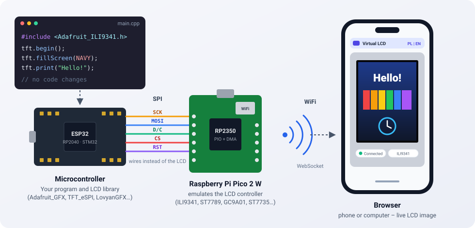
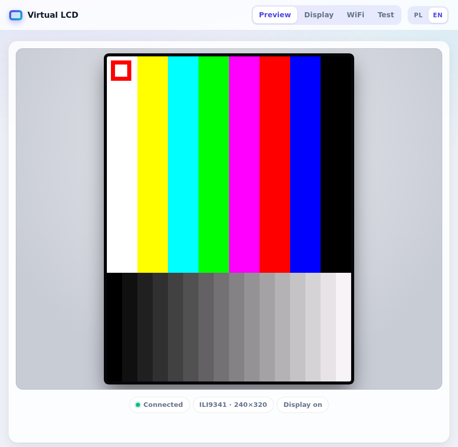
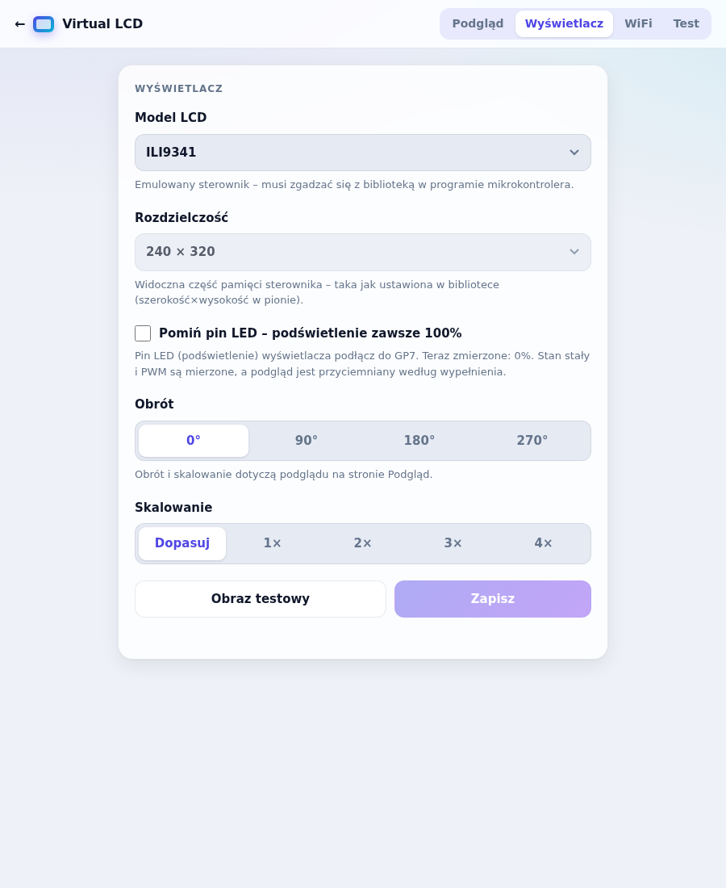
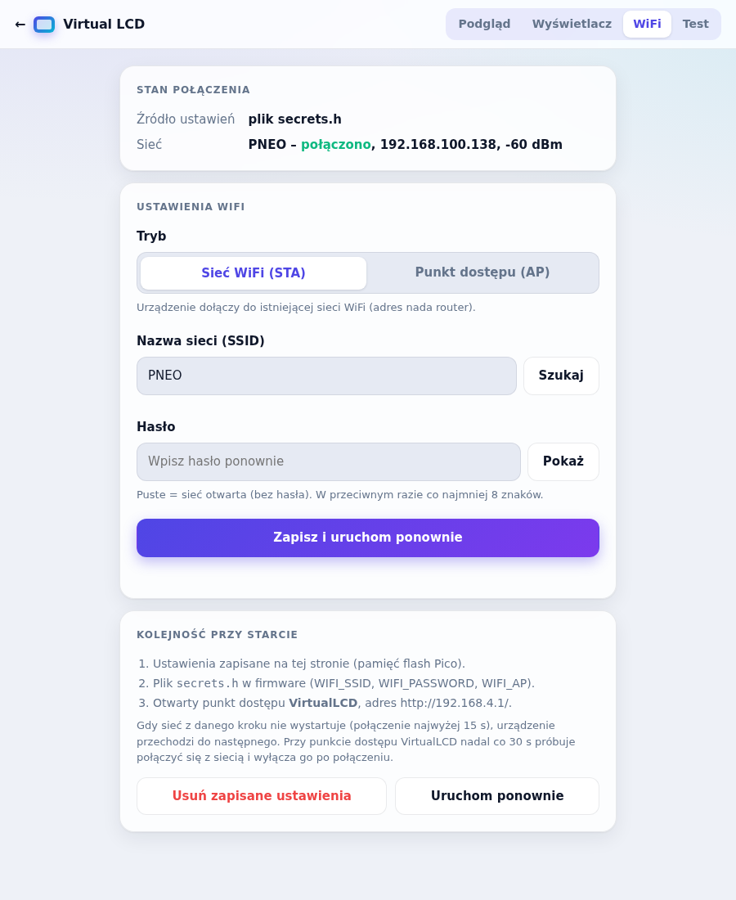
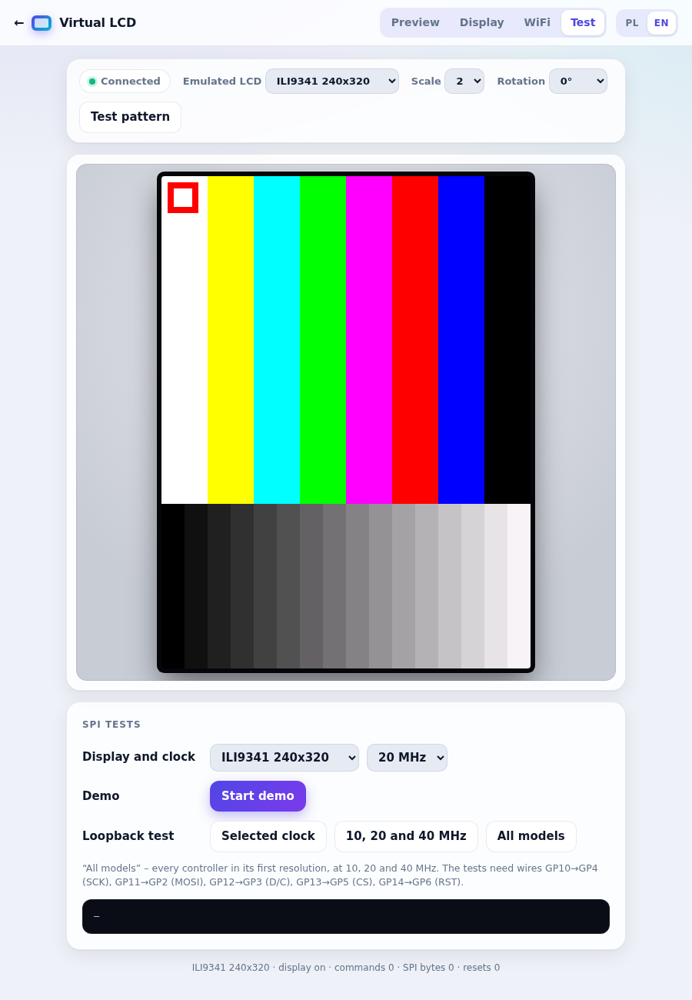

<a id="english"></a>

# VirtualLcd – Raspberry Pi Pico 2 W

**English** · [Polski (wersja polska)](#polski)

## What it is for

VirtualLcd is a **virtual LCD display**. A Raspberry Pi Pico 2 W is connected to the SPI bus in place of
a real display (ILI9341, ST7789, GC9A01, ST7735…). The Pico receives commands and pixels just like an LCD
controller and shows the image on a web page, in a browser on a computer or a phone.

The program on the microcontroller (ESP32, RP2040, STM32…) and its graphics library (Adafruit_GFX, TFT_eSPI,
LovyanGFX…) **work without any changes**. No physical display is needed.



The microcontroller sends commands and pixels over SPI exactly as it would to a real display. The Pico 2 W,
wired in place of the LCD, receives them, builds the image and sends it over WiFi to a browser on a phone
or computer.

Useful for:
- writing and running a program with a display when you have no display, or it is too small to see
  the details (preview zoomed 1–4×),
- checking what the library really sends: rotation, window offset (colstart/rowstart), inversion,
  RGB/BGR color order, display off, backlight brightness,
- showing the device's screen to other people (up to 3 browsers at once),
- SPI performance tests up to 40 MHz (capture and overrun statistics).

## Web panel

The Pico's address is printed in the serial log at startup (or shown by the router). Without a configured
network the Pico creates an open access point **VirtualLCD**, and the panel is at http://192.168.4.1/.
All pages have a menu at the top: Preview, Display, WiFi and Test.

The panel is in Polish or English – the **PL / EN** switch is in the top bar (on a narrow screen only the
button of the other language is shown). The choice is saved on the device, so after a restart the pages
come in the saved language right away, in every browser. The test log on the Test page stays in Polish.

The screenshots below show the Polish version of the panel.

### Preview (`/`)



Live image of the emulated display, refreshed over WebSocket (only changed regions, RLE compressed).
- Rotation and zoom according to the settings on the Display page ("Fit" = to the browser window size).
- Below the image: connection status, model and resolution, display state (on/off, inversion)
  and the measured backlight level.
- The preview mirrors the display state: a display that is off (DISPOFF, sleep) is black, color inversion
  is visible, and the image is dimmed according to the backlight on the LED pin. A round panel (GC9A01) has a round mask.
- Reloading the page or going to another panel page closes the previous connection of the same browser.

The screenshot shows the test pattern (color bars, gray scale, orientation marker in the top left corner).

### Display (`/lcd`)



Settings of the emulated display:
- **LCD model** – drop-down list of emulated controllers. It must match the library in the microcontroller program.
- **Resolution** – panels available for the selected controller (e.g. ST7789: 240×320, 240×240, 135×240…).
  Each one has its own window in the controller memory, like the offset set in the library. When a controller
  has only one resolution, the list is disabled.
- **Ignore the LED pin** – backlight always 100 %. When unchecked, the preview is dimmed according to the signal
  on GP7 (steady level or PWM). The currently measured value is shown next to it.
- **Rotation** and **Scaling** – only for the preview on the Preview page.
- **Test pattern** – the Pico draws a test pattern in the selected panel by itself, without a second microcontroller.
- **Save** – saves to flash. Model and resolution apply immediately, and all settings are loaded at startup.
  The button is active only when there are unsaved changes.

### WiFi (`/wifi`)



- **Connection status** – where the settings come from (the page, `secrets.h`, fallback access point), network name,
  IP address and signal strength.
- **Mode** – join an existing network (STA) or create an own access point (AP).
- **Network name** with a **Scan** button (list of nearby networks) and **password** (empty = open network).
- **Save and restart** – after the restart the page waits for the device and suggests the new address.
- **Delete saved settings** (back to `secrets.h` or the VirtualLCD access point) and **Restart**.
- Description of the order in which WiFi settings are tried at startup.

### Test (`/test`)



A page for checking the emulator without a second microcontroller:
- At the top: quick change of the emulated LCD (model + resolution, not saved), preview scale and rotation, test pattern.
- Preview with counters: commands, SPI bytes, overruns, broken bytes, resets.
- **Demo** – the SPI transmitter of the same Pico draws rectangles, text and an animated clock for the selected
  display and SPI clock (10, 20 or 40 MHz).
- **Loopback test** – initialization as in the library, a full image in which every pixel is different,
  and a rectangle in rotation 1. Then a comparison with what the emulator received: wrong pixels, byte count,
  display state. Selected clock, all clocks (10, 20, 40 MHz) or all models.
- Test log in the black box at the bottom.

Demo and test need the transmitter wires (see "Loopback test and demo" below).

### Diagnostics (`/status`)

JSON for a computer (e.g. `curl http://<address>/status`): capture counters (bytes, commands, overruns,
peak load of core 1 and throughput), web connections (clients, disconnects, send errors, throughput),
WiFi (RSSI), free memory and uptime.

## How it works

**PIO** assembles the bits in hardware. On every SCK edge it shifts in MOSI and D/C, and after 8 bits it outputs
one 16-bit word per SPI byte. CS is checked at the start of every byte, so the clock of other devices on a shared
bus is ignored.

## Framework

PlatformIO + [arduino-pico](https://github.com/earlephilhower/arduino-pico) (earlephilhower), maxgerhardt platform:
- full pico-sdk 2.x (PIO, DMA, `pio_claim_free_sm_and_add_program_for_gpio_range`),
- CYW43439 WiFi through lwIP (`WiFi`, `WiFiServer`),
- both cores: `setup()/loop()` on core 0, `setup1()/loop1()` on core 1,
- pioasm included – `tools/pioasm.py` generates `*.pio.h` before compiling.

## Work split

| Core | Task |
|------|------|
| 0 | WiFi, HTTP + WebSocket server, loopback test, demo |
| 1 | capture only: reading the DMA ring, decoding, LCD controller |

CPU clock 250 MHz (`board_build.f_cpu`, core voltage 1.20 V set in `main.cpp`).
The PIO loop takes 3 instructions per bit, which leaves headroom up to about 60 MHz SPI.

## Wiring

| Microcontroller with the program | Pico 2 W |
|----------------------------------|----------|
| MOSI / SDA / DIN                 | GP2      |
| D/C (RS, A0)                     | GP3      |
| SCK / CLK                        | GP4      |
| CS                               | GP5      |
| RST (optional)                   | GP6      |
| LED / BL (optional)              | GP7      |
| GND                              | GND      |

MOSI, D/C, SCK and CS must be consecutive GPIOs (this is how PIO reads them). 3.3 V levels (the Pico is not
5 V tolerant). SPI mode 0. A common ground is required.

### Loopback test and demo

The test transmitter is the hardware SPI1 of the same Pico. Wires:
GP10→GP4 (SCK), GP11→GP2 (MOSI), GP12→GP3 (D/C), GP13→GP5 (CS), GP14→GP6 (RST).
The microcontroller with the program must be disconnected then.

The transmitter SPI clock comes from a divider of the peripheral clock, so "40 MHz" may end up as e.g. 33.3 MHz –
the log shows the actual value.

## Getting started

1. Optionally copy `include/secrets.h.example` to `include/secrets.h` and enter the WiFi data
   (`WIFI_AP 1` = own access point, `0` or missing = join a network).
2. `pio run -t upload` (Pico in BOOTSEL mode the first time), then `pio device monitor`.
3. Open the address from the log. Diagnostics: `http://<address>/status`.

WiFi settings order at startup: saved on the page (flash) → `secrets.h` → open access point
**VirtualLCD** (http://192.168.4.1/). When the network from a step does not start (at most 15 s),
the next one is tried. While running the VirtualLCD access point, the device tries to join the network
every 3 minutes, but only when nobody is connected to the access point (CYW43 cannot do both at once).

## Pages

| Address | Content |
|---------|---------|
| `/` | image preview (rotation and scaling from the Display page settings) |
| `/lcd` | LCD model, resolution, rotation, scaling, test pattern, "Save" (flash, loaded at startup) |
| `/wifi` | network status, STA/AP mode, SSID (with scanning), password (empty = open network) |
| `/test` | loopback test, SPI demo, capture statistics |
| `/status` | diagnostics in JSON |

Up to 3 browser tabs get the same image at once. The WebSocket carries: the controller list once after connecting
(`drivers`), the state every second (`info`), the test log (`test`) and image regions (binary, RGB565, optionally RLE).

## Settings

Stored in the files `/lcd.bin`, `/wifi.bin` and `/ui.bin` (panel language) on LittleFS – a 64 KB partition at the
end of flash (`board_build.filesystem_size`). Writing to flash pauses core 1 for a moment, so SPI capture stops
during that time – this happens only after clicking "Save" on a page or changing the language.
Uploading a new program does not erase the settings (the partition is outside the program area).

## Code structure

| File | Role |
|------|------|
| `VirtualLcd` | main class: controller registry `kDrivers`, frame buffer, capture (core 1), web and tests (core 0) |
| `drivers/*` | LCD controllers: `MipiDcsDriver` (common commands) and derived classes with a panel list `kPanels` |
| `capture/spi_capture.pio` | PIO program: MOSI + D/C on the SCK edge, byte after CS |
| `capture/PioSpiCapture` | PIO + DMA (32 KB ring) + table decoding |
| `web/WebServer` | HTTP + WebSocket on `WiFiServer`: pages, settings API, up to 3 clients |
| `web/Pages`, `web/TestHtml` | pages `/`, `/lcd`, `/wifi` and `/test` in Polish + shared styles and scripts (macros) |
| `web/PagesEn`, `web/TestHtmlEn` | the same pages in English |
| `net/Wifi` | WiFi: STA, AP, fallback AP, network scan |
| `Settings` | settings on LittleFS (display, WiFi, panel language) |
| `test/SpiLcdMaster` | transmitter: hardware SPI, `kProfiles` profiles with the init sequences of libraries |
| `test/LoopbackTester`, `test/DemoSender` | loopback test and demo |

## Resolutions

Every controller class has a `kPanels` list (e.g. `St7789Driver.h`): name, width, height and the position
of the visible window in the controller memory – the offset that libraries add in CASET/RASET
("colstart/rowstart"). The preview on the page shows only that window.

| Controller | Resolutions |
|------------|-------------|
| ILI9341 | 240×320 |
| ST7789 | 240×320, 240×280, 240×240, 172×320, 170×320, 135×240 (window x=52 like TFT_eSPI; Adafruit uses 53), 76×284 |
| GC9A01 | 240×240, round (preview with a round mask) |
| ST7735, ST7735R, ST7735S | 128×160 "green tab" (window 2,1, BGR), 128×128 (window 2,3 like Adafruit 144GREENTAB, BGR), 80×160 IPS (window 26,1 like TFT_eSPI/LovyanGFX – Adafruit uses 24,0; RGB, INVON) |

A new resolution = a new entry in `kPanels` of the given controller. The loopback test and demo draw in the window
of the selected resolution, just like a library would.

## LED pin (backlight)

GP7 measures the backlight signal: steady level or PWM (the RP2350 PWM counter counts cycles while the level
is high, 50 ms window). The preview on the page is dimmed according to the duty cycle. On the Display page you
can check "Ignore the LED pin" – then the backlight is always 100 % (the default, because without a wire the
pin reads 0). The LED pin must be an odd GPIO (channel B of a PWM slice).

## How to add a new LCD

The controller list on the web pages (Display, Test) is built from the firmware, so the HTML does not change.

### 1. Controller class – `src/drivers/<Name>Driver.h`

Most SPI displays are MIPI DCS compatible (CASET/RASET/RAMWR, MADCTL, COLMOD, INVON, DISPON) –
then the class derives from `MipiDcsDriver` and only provides constants:

```cpp
#pragma once

#include "MipiDcsDriver.h"

class Ili9488Driver : public MipiDcsDriver {
public:
    // Controller name - also on the page, in the settings and in the test profiles (test/SpiLcdMaster.cpp).
    static constexpr const char* kName = "ILI9488";

    // Panel resolutions (first = default): name, width, height, window x, y in memory
    // [, round, bgr, inverted - panel-dependent traits, -1 = controller trait].
    static constexpr PanelSize kPanels[] = {
        {"320x480", 320, 480, 0, 0},
    };

    // Frame memory (width, height), BGR panel, X mirror, IPS (inverted colors), [Y mirror].
    Ili9488Driver() : MipiDcsDriver({320, 480, true, true, false}) {}

    const char* name() const override { return kName; }

    // Test pattern from the page button: minimal sequence as in the library.
    void testInit(const PanelSize& panel) override { ... testPattern(panel); }
};
```

Panel traits (`PanelTraits`) are chosen so that what the library sends in rotation 0 gives a straight image:
- `bgr` – the library sets the BGR bit in MADCTL (the panel has BGR order),
- `mirrorX` / `mirrorY` – the library sends MX / MY in rotation 0 (the panel is mounted mirrored),
- `inverted` – the library sends INVON (IPS panel).

Vendor commands that change the image (e.g. ILI9341 0xB6 – scan direction) are handled in `onParam()`.
When several chip versions share the same commands (ST7735, ST7735R, ST7735S), the common logic and panel list
go to a base class (`St7735Base`), and each version is a separate small file with `kName`.

### 2. Controller registry – `src/VirtualLcd.cpp`

The header in `#include` and one entry in `kDrivers`:

```cpp
{Ili9488Driver::kName, []() -> LcdDriver* { return new Ili9488Driver(); }, Ili9488Driver::kPanels,
 countOf(Ili9488Driver::kPanels)},
```

The frame buffer (RGB565, 2 B per pixel) is allocated at startup for the largest controller. Today that is
240×320 = 150 KB, with about 125 KB of RAM left free – a 320×480 memory (300 KB) would no longer fit
and would need e.g. a buffer with a lower color depth.

### 3. Test profile – `src/test/SpiLcdMaster.cpp` (for the demo and loopback test)

An init sequence as in a typical library (`LcdInitCmd`: command, parameter count, up to 16 parameters,
delay in ms) and an entry in `kProfiles`:

```cpp
{Ili9488Driver::kName, kIli9488Init, sizeof(kIli9488Init) / sizeof(LcdInitCmd), 320, 480, 0x48, 0x28},
//                                                                  frame memory, MADCTL rot. 0, rot. 1
```

Without a profile the controller works normally, only the demo and loopback test will not support it.

### 4. Checking

- `pio run` – build.
- Test page → loopback test for the new model (all clocks) – must report "OK".
- With a real microcontroller and library: rotation 0–3, colors (RGB/BGR), inversion and window offset.

## License

Copyright (C) 2026 Tomasz (https://github.com/TomaszOp)

The VirtualLcd code is released under the [GNU General Public License v3.0](LICENSE) (GPL-3.0-or-later).

---

<a id="polski"></a>

# VirtualLcd – Raspberry Pi Pico 2 W (po polsku)

[English](#english) · **Polski**

## Do czego to jest

VirtualLcd to **wirtualny wyświetlacz LCD**. Raspberry Pi Pico 2 W podłącza się do magistrali SPI
w miejsce prawdziwego wyświetlacza (ILI9341, ST7789, GC9A01, ST7735…). Pico odbiera komendy i piksele
tak jak sterownik LCD, a obraz pokazuje na stronie WWW, w przeglądarce na komputerze albo telefonie.

Program na mikrokontrolerze (ESP32, RP2040, STM32…) i jego biblioteka graficzna (Adafruit_GFX, TFT_eSPI,
LovyanGFX…) **działają bez żadnych zmian**. Nie trzeba mieć fizycznego wyświetlacza.


Mikrokontroler wysyła komendy i piksele przez SPI tak jak do prawdziwego wyświetlacza. Pico 2 W podłączone
w miejsce LCD odbiera je, składa obraz i przez WiFi wysyła go do przeglądarki na telefonie albo komputerze.

Do czego się przydaje:
- pisanie i uruchamianie programu z wyświetlaczem, gdy wyświetlacza nie ma albo jest za mały, żeby
  przyjrzeć się szczegółom (podgląd w powiększeniu 1–4×),
- sprawdzanie, co biblioteka faktycznie wysyła: obrót, przesunięcie okna (colstart/rowstart), inwersja,
  kolejność kolorów RGB/BGR, wyłączanie ekranu, jasność podświetlenia,
- pokazywanie obrazu z urządzenia innym osobom (do 3 przeglądarek naraz),
- testy wydajności SPI do 40 MHz (statystyki przechwytywania i przepełnień).

## Panel WWW

Adres Pico podaje log szeregowy przy starcie (albo router). Bez skonfigurowanej sieci Pico tworzy
otwarty punkt dostępu **VirtualLCD**, a panel jest pod http://192.168.4.1/. Wszystkie strony mają
u góry menu: Podgląd, Wyświetlacz, WiFi i Test.

Panel jest po polsku albo po angielsku – przełącznik **PL / EN** jest w górnej belce (na wąskim ekranie
widać tylko przycisk drugiego języka). Wybór jest zapisywany w urządzeniu, więc po restarcie strony od razu
są w zapisanym języku, w każdej przeglądarce. Log testów na stronie Test zostaje po polsku.

### Podgląd (`/`)


Obraz emulowanego wyświetlacza na żywo, odświeżany przez WebSocket (tylko zmienione fragmenty,
z kompresją RLE).
- Obrót i powiększenie według ustawień ze strony Wyświetlacz („Dopasuj” = do wielkości okna przeglądarki).
- Pod obrazem: stan połączenia, model i rozdzielczość, stan ekranu (włączony/wyłączony, inwersja)
  i zmierzona jasność podświetlenia.
- Podgląd odwzorowuje stan wyświetlacza: wyłączony ekran (DISPOFF, uśpienie) jest czarny, inwersja kolorów
  jest widoczna, a obraz jest przyciemniany według podświetlenia z pinu LED. Okrągły panel (GC9A01) ma okrągłą maskę.
- Odświeżenie strony albo przejście na inną stronę panelu zamyka poprzednie połączenie tej samej przeglądarki.

Na zrzucie widać obraz testowy (paski kolorów, skala szarości, znacznik orientacji w lewym górnym rogu).

### Wyświetlacz (`/lcd`)


Ustawienia emulowanego wyświetlacza:
- **Model LCD** – lista rozwijana z emulowanymi sterownikami. Musi się zgadzać z biblioteką w programie mikrokontrolera.
- **Rozdzielczość** – panele dostępne dla wybranego sterownika (np. ST7789: 240×320, 240×240, 135×240…).
  Każdy ma swoje okno w pamięci sterownika, takie jak przesunięcie ustawiane w bibliotece. Gdy sterownik ma
  jedną rozdzielczość, lista jest nieaktywna.
- **Pomiń pin LED** – podświetlenie zawsze 100 %. Bez zaznaczenia podgląd jest przyciemniany według sygnału
  na GP7 (stan stały albo PWM). Obok widać aktualnie zmierzoną wartość.
- **Obrót** i **Skalowanie** – tylko dla podglądu na stronie Podgląd.
- **Obraz testowy** – Pico samo rysuje obraz testowy w wybranym panelu, bez drugiego mikrokontrolera.
- **Zapisz** – zapis do flasha. Model i rozdzielczość działają od razu, a wszystkie ustawienia są
  wczytywane przy starcie. Przycisk jest aktywny tylko przy niezapisanych zmianach.

### WiFi (`/wifi`)


- **Stan połączenia** – skąd pochodzą ustawienia (strona, `secrets.h`, awaryjny punkt dostępu), nazwa sieci,
  adres IP i siła sygnału.
- **Tryb** – połączenie z istniejącą siecią (STA) albo własny punkt dostępu (AP).
- **Nazwa sieci** z przyciskiem **Szukaj** (lista sieci w pobliżu) i **hasło** (puste = sieć otwarta).
- **Zapisz i uruchom ponownie** – po restarcie strona czeka na urządzenie i podpowiada nowy adres.
- **Usuń zapisane ustawienia** (powrót do `secrets.h` albo punktu dostępu VirtualLCD) i **Uruchom ponownie**.
- Opis kolejności, w jakiej ustawienia WiFi są próbowane przy starcie.

### Test (`/test`)


Strona do sprawdzania emulatora bez drugiego mikrokontrolera:
- U góry: szybka zmiana emulowanego LCD (model + rozdzielczość, bez zapisu), skala i obrót podglądu, obraz testowy.
- Podgląd z liczbami: komendy, bajty SPI, przepełnienia, urwane bajty, resety.
- **Demo** – nadajnik SPI tego samego Pico rysuje prostokąty, napisy i animowany zegar dla wybranego
  wyświetlacza i zegara SPI (10, 20 albo 40 MHz).
- **Test pętli zwrotnej** – inicjalizacja jak w bibliotece, pełny obraz, w którym każdy piksel jest inny,
  i prostokąt w rotacji 1. Potem porównanie z tym, co odebrał emulator: błędne piksele, liczba bajtów,
  stan ekranu. Do wyboru wybrany zegar, wszystkie zegary (10, 20, 40 MHz) albo wszystkie modele.
- Log testu w czarnym polu na dole.

Demo i test wymagają przewodów nadajnika (opis niżej w „Test pętli zwrotnej i demo”).

### Diagnostyka (`/status`)

JSON dla komputera (np. `curl http://<adres>/status`): liczniki przechwytywania (bajty, komendy, przepełnienia,
szczytowe obciążenie rdzenia 1 i przepływność), połączenia WWW (klienci, rozłączenia, błędy wysyłki,
przepływność), WiFi (RSSI), wolna pamięć i czas pracy.

## Jak to działa

**PIO** składa bity sprzętowo. Na każde zbocze SCK wsuwa MOSI i D/C, a po 8 bitach oddaje jedno słowo 16-bit na bajt SPI.
CS jest sprawdzany na początku każdego bajtu, więc zegar innych urządzeń na wspólnej szynie jest pomijany.

## Framework

PlatformIO + [arduino-pico](https://github.com/earlephilhower/arduino-pico) (earlephilhower), platforma maxgerhardt:
- pełne pico-sdk 2.x (PIO, DMA, `pio_claim_free_sm_and_add_program_for_gpio_range`),
- WiFi CYW43439 przez lwIP (`WiFi`, `WiFiServer`),
- oba rdzenie: `setup()/loop()` na rdzeniu 0, `setup1()/loop1()` na rdzeniu 1,
- pioasm w pakiecie – `tools/pioasm.py` generuje `*.pio.h` przed kompilacją.

## Podział pracy

| Rdzeń | Zadanie |
|-------|---------|
| 0 | WiFi, serwer HTTP + WebSocket, test pętli zwrotnej, demo |
| 1 | tylko przechwytywanie: odczyt pierścienia DMA, dekodowanie, sterownik LCD |

Zegar CPU 250 MHz (`board_build.f_cpu`, napięcie rdzenia 1,20 V ustawiane w `main.cpp`).
Pętla PIO to 3 instrukcje na bit, więc zapas do ok. 60 MHz SPI.

## Połączenie

| Mikrokontroler z programem | Pico 2 W |
|----------------------------|----------|
| MOSI / SDA / DIN           | GP2      |
| D/C (RS, A0)               | GP3      |
| SCK / CLK                  | GP4      |
| CS                         | GP5      |
| RST (opcjonalnie)          | GP6      |
| LED / BL (opcjonalnie)     | GP7      |
| GND                        | GND      |

MOSI, D/C, SCK, CS muszą być kolejnymi GPIO (tak czyta je PIO). Poziomy 3,3 V (Pico nie toleruje 5 V).
Tryb SPI 0. Wspólna masa jest konieczna.

### Test pętli zwrotnej i demo

Nadajnik testowy to sprzętowe SPI1 tego samego Pico. Przewody:
GP10→GP4 (SCK), GP11→GP2 (MOSI), GP12→GP3 (D/C), GP13→GP5 (CS), GP14→GP6 (RST).
Mikrokontroler z programem musi być wtedy odłączony.

Zegar SPI nadajnika powstaje z dzielnika zegara peryferiów, więc „40 MHz” może wyjść np. 33,3 MHz –
log podaje rzeczywistą wartość.

## Uruchomienie

1. Opcjonalnie skopiuj `include/secrets.h.example` do `include/secrets.h` i wpisz dane WiFi
   (`WIFI_AP 1` = własny punkt dostępu, `0` lub brak = połączenie z siecią).
2. `pio run -t upload` (Pico w trybie BOOTSEL za pierwszym razem), potem `pio device monitor`.
3. Otwórz adres z logu. Diagnostyka: `http://<adres>/status`.

Kolejność ustawień WiFi przy starcie: zapisane na stronie (flash) → `secrets.h` → otwarty punkt
dostępu **VirtualLCD** (http://192.168.4.1/). Gdy sieć z danego kroku nie wystartuje (najwyżej 15 s),
próbowany jest następny. Przy punkcie dostępu VirtualLCD urządzenie co 3 minuty próbuje połączyć się
z siecią, ale tylko gdy nikt nie jest podłączony do punktu dostępu (CYW43 nie robi obu rzeczy naraz).

## Strony

| Adres | Zawartość |
|-------|-----------|
| `/` | podgląd obrazu (obrót i skalowanie wg ustawień ze strony Wyświetlacz) |
| `/lcd` | model LCD, rozdzielczość, obrót, skalowanie, obraz testowy, „Zapisz” (flash, wczytywane przy starcie) |
| `/wifi` | stan sieci, tryb STA/AP, SSID (z wyszukiwaniem), hasło (puste = sieć otwarta) |
| `/test` | test pętli zwrotnej, demo przez SPI, statystyki przechwytywania |
| `/status` | diagnostyka w JSON |

Do 3 kart przeglądarki naraz dostaje ten sam obraz. Przez WebSocket idą: lista sterowników raz po połączeniu
(`drivers`), stan co sekundę (`info`), log testów (`test`) i fragmenty obrazu (binarnie, RGB565, opcjonalnie RLE).

## Ustawienia

Zapisywane w plikach `/lcd.bin`, `/wifi.bin` i `/ui.bin` (język panelu) na LittleFS – partycja 64 KB na końcu flasha
(`board_build.filesystem_size`). Zapis do flasha na chwilę wstrzymuje rdzeń 1, więc w tym czasie
przechwytywanie SPI stoi – dzieje się to tylko po kliknięciu „Zapisz” na stronie albo zmianie języka.
Wgranie nowego programu nie kasuje ustawień (partycja jest poza obszarem programu).

## Budowa

| Plik | Rola |
|------|------|
| `VirtualLcd` | centralna klasa: rejestr sterowników `kDrivers`, bufor obrazu, przechwytywanie (rdzeń 1), WWW i testy (rdzeń 0) |
| `drivers/*` | sterowniki LCD: `MipiDcsDriver` (wspólne komendy) i klasy pochodne z listą paneli `kPanels` |
| `capture/spi_capture.pio` | program PIO: MOSI + D/C na zbocze SCK, bajt po CS |
| `capture/PioSpiCapture` | PIO + DMA (pierścień 32 KB) + dekodowanie tablicą |
| `web/WebServer` | HTTP + WebSocket na `WiFiServer`: strony, API ustawień, do 3 klientów |
| `web/Pages`, `web/TestHtml` | strony `/`, `/lcd`, `/wifi` i `/test` po polsku + wspólne style i skrypty (makra) |
| `web/PagesEn`, `web/TestHtmlEn` | te same strony po angielsku |
| `net/Wifi` | WiFi: STA, AP, awaryjny AP, wyszukiwanie sieci |
| `Settings` | ustawienia na LittleFS (wyświetlacz, WiFi, język panelu) |
| `test/SpiLcdMaster` | nadajnik: sprzętowe SPI, profile `kProfiles` z sekwencjami startowymi bibliotek |
| `test/LoopbackTester`, `test/DemoSender` | test pętli zwrotnej i demo |

## Rozdzielczości

Każda klasa sterownika ma listę `kPanels` (np. `St7789Driver.h`): nazwa, szerokość, wysokość i położenie
widocznego okna w pamięci sterownika – takie przesunięcie biblioteki dodają w CASET/RASET
(„colstart/rowstart”). Podgląd na stronie pokazuje tylko to okno.

| Sterownik | Rozdzielczości |
|-----------|----------------|
| ILI9341 | 240×320 |
| ST7789 | 240×320, 240×280, 240×240, 172×320, 170×320, 135×240 (okno x=52 jak TFT_eSPI; Adafruit używa 53), 76×284 |
| GC9A01 | 240×240, okrągły (podgląd z okrągłą maską) |
| ST7735, ST7735R, ST7735S | 128×160 „green tab” (okno 2,1, BGR), 128×128 (okno 2,3 jak Adafruit 144GREENTAB, BGR), 80×160 IPS (okno 26,1 jak TFT_eSPI/LovyanGFX – Adafruit używa 24,0; RGB, INVON) |

Nowa rozdzielczość = nowy wpis w `kPanels` danego sterownika. Test pętli i demo rysują w oknie wybranej
rozdzielczości, tak jak robiłaby to biblioteka.

## Pin LED (podświetlenie)

GP7 mierzy sygnał podświetlenia: stan stały albo PWM (licznik PWM RP2350 zlicza takty przy stanie wysokim,
okno 50 ms). Podgląd na stronie jest przyciemniany według wypełnienia. Na stronie Wyświetlacz można
zaznaczyć „Pomiń pin LED” – wtedy podświetlenie jest zawsze 100 % (domyślnie, bo bez połączenia pin czyta 0).
Pin LED musi być nieparzystym GPIO (kanał B plastra PWM).

## Jak dodać nowy LCD

Lista sterowników na stronach WWW (Wyświetlacz, Test) jest budowana z firmware, więc HTML się nie zmienia.

### 1. Klasa sterownika – `src/drivers/<Nazwa>Driver.h`

Większość wyświetlaczy SPI jest zgodna z MIPI DCS (CASET/RASET/RAMWR, MADCTL, COLMOD, INVON, DISPON) –
wtedy klasa dziedziczy po `MipiDcsDriver` i podaje tylko stałe:

```cpp
#pragma once

#include "MipiDcsDriver.h"

class Ili9488Driver : public MipiDcsDriver {
public:
    // Nazwa sterownika - takze na stronie, w ustawieniach i w profilach testow (test/SpiLcdMaster.cpp).
    static constexpr const char* kName = "ILI9488";

    // Rozdzielczosci paneli (pierwsza = domyslna): nazwa, szerokosc, wysokosc, okno x, y w pamieci
    // [, okragly, bgr, inverted - cechy zalezne od szyby, -1 = cecha sterownika].
    static constexpr PanelSize kPanels[] = {
        {"320x480", 320, 480, 0, 0},
    };

    // Pamiec obrazu (szerokosc, wysokosc), panel BGR, lustro X, IPS (odwrocone kolory), [lustro Y].
    Ili9488Driver() : MipiDcsDriver({320, 480, true, true, false}) {}

    const char* name() const override { return kName; }

    // Obraz testowy z przycisku na stronie: minimalna sekwencja jak w bibliotece.
    void testInit(const PanelSize& panel) override { ... testPattern(panel); }
};
```

Cechy panelu (`PanelTraits`) dobiera się tak, żeby to, co biblioteka wysyła w rotacji 0, dało prosty obraz:
- `bgr` – biblioteka ustawia bit BGR w MADCTL (panel ma kolejność BGR),
- `mirrorX` / `mirrorY` – biblioteka w rotacji 0 wysyła MX / MY (panel zamontowany w lustrze),
- `inverted` – biblioteka wysyła INVON (panel IPS).

Komendy producenta, które zmieniają obraz (np. ILI9341 0xB6 – kierunek skanowania), obsługuje się w `onParam()`.
Gdy kilka wersji układu ma te same komendy (ST7735, ST7735R, ST7735S), wspólna logika i lista paneli
idą do klasy bazowej (`St7735Base`), a każda wersja to osobny mały plik z `kName`.

### 2. Rejestr sterowników – `src/VirtualLcd.cpp`

Nagłówek w `#include` i jeden wpis w `kDrivers`:

```cpp
{Ili9488Driver::kName, []() -> LcdDriver* { return new Ili9488Driver(); }, Ili9488Driver::kPanels,
 countOf(Ili9488Driver::kPanels)},
```

Bufor obrazu (RGB565, 2 B na piksel) jest przydzielany przy starcie na największy sterownik. Dziś to
240×320 = 150 KB, a wolnego RAM zostaje ok. 125 KB – pamięć 320×480 (300 KB) już by się nie zmieściła
i wymagałaby np. bufora o mniejszej głębi kolorów.

### 3. Profil testowy – `src/test/SpiLcdMaster.cpp` (dla demo i testu pętli)

Sekwencja startowa jak w typowej bibliotece (`LcdInitCmd`: komenda, liczba parametrów, do 16 parametrów,
opóźnienie ms) i wpis w `kProfiles`:

```cpp
{Ili9488Driver::kName, kIli9488Init, sizeof(kIli9488Init) / sizeof(LcdInitCmd), 320, 480, 0x48, 0x28},
//                                                                  pamiec obrazu, MADCTL rot. 0, rot. 1
```

Bez profilu sterownik działa normalnie, tylko demo i test pętli go nie obsłużą.

### 4. Sprawdzenie

- `pio run` – kompilacja.
- Strona Test → test pętli zwrotnej dla nowego modelu (wszystkie zegary) – musi dać „OK”.
- Z prawdziwym mikrokontrolerem i biblioteką: obrót 0–3, kolory (RGB/BGR), inwersja i przesunięcie okna.

## Licencja

Copyright (C) 2026 Tomasz (https://github.com/TomaszOp)

Kod VirtualLcd jest udostępniony na [licencji GNU GPL v3.0](LICENSE) (GPL-3.0-or-later).
